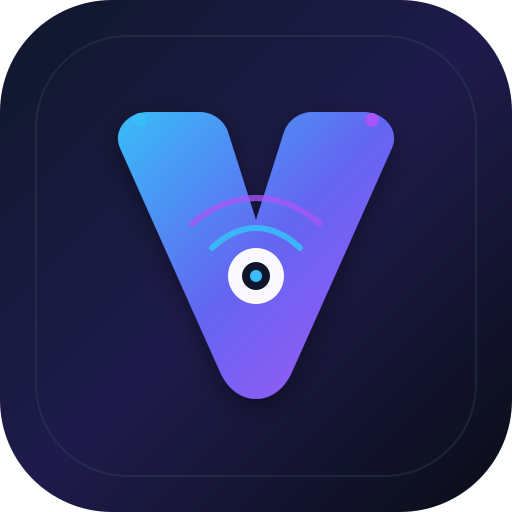

<p align="center">
  
</p>

<h1 align="center">Veyqo</h1>

<p align="center">
  <strong>High-performance, local-first remote device bridge for Windows, Linux, and Android.</strong>
</p>

<p align="center">
  <a href="https://github.com/SyntX34/Veyqo/actions"></a>
  <a href="LICENSE"></a>
  <a href="https://github.com/SyntX34"></a>
  <a href="CONTRIBUTING.md"></a>
</p>

---

## Overview

**Veyqo** is a peer-to-peer remote device bridge designed for high-performance screen streaming and touch/input control over your local area network (LAN/Wi-Fi). It requires no internet access, cloud relays, or subscriptions.

- **Desktop Controller (C# / Avalonia UI):** Cross-platform desktop application for Windows and Linux x64 with native rendering, QR code generation, SkiaSharp video decoding, and low-latency input streaming.
- **Mobile Server (Android / Java):** Background service that listens on local port `55443`, captures frames via hardware-accelerated `MediaProjection` and `MediaCodec` (H.264), and injects touch gestures via Android's `AccessibilityService` (supports Android 8.0 Oreo through Android 14+).

---

## Key Features

- **Bi-directional Discovery & Pairing:**
  - **QR Code Scan:** Desktop generates a local pairing payload (`veyqo://connect?host=...&port=...`). Scanning with your phone's camera opens an authorization prompt.
  - **Direct Port Connection:** Open port `55443` on mobile, enter the phone's local IP on PC, and connect directly.
- **Banking-Style Device Authorization:**
  - Scanning a QR code triggers an explicit device authorization modal prompt on the phone before establishing any screen stream or remote control session.
- **Hardware-Accelerated Screen Streaming (Phase 2):**
  - **Mobile:** Encodes low-latency 60 FPS video using hardware H.264/AVC (`MediaCodec`) with dynamic adaptive bitrate adjustment.
  - **Desktop:** Fast frame decoding and rendering powered by `SkiaSharp`.
- **Dynamic Day & Night Theme Support:**
  - Dedicated day/night toggle button (`☀️` / `🌙`) dynamically adapting UI palettes on desktop and Android.
  - Automatic OS theme detection tracking system preferences.
- **Multi-Format Packaging & CI/CD:**
  - **Windows:** Standard Setup Wizard (`.exe`), Windows Installer (`.msi`), and standalone executable.
  - **Linux:** Native Debian packages (`.deb`) with desktop launcher integration.
  - **Android:** Installable signed official release APK (`minSdk 26`, Android 8.0+).
  - **Continuous Delivery:** Automated GitHub Actions pipeline building all platforms on commit/PR, with releases triggered on demand (`workflow_dispatch`).

---

## Project Structure

```
Veyqo/
├── .github/workflows/
│   └── build-and-release.yml   # Multi-platform CI/CD and release pipeline
├── .vscode/
│   └── settings.json           # Workspace editor configuration
├── assets/
│   ├── logo.svg                # Geometric vector branding logo
│   └── logo.ico                # Multi-resolution Windows icon
├── desktop/
│   ├── Assets/
│   │   ├── github.svg          # GitHub branding asset
│   │   ├── logo.ico            # Windows icon resource
│   │   └── logo.svg            # Scalable desktop icon
│   ├── Network/
│   │   ├── ControlPacket.cs    # Structured binary packet definitions
│   │   ├── NetworkDiscovery.cs # Local IP and connection payload builder
│   │   ├── RemoteClient.cs     # Asynchronous TCP client
│   │   ├── RemoteServer.cs     # Desktop TCP listener for QR connections
│   │   └── VideoFrameDecoder.cs# SkiaSharp hardware frame decoder
│   ├── Views/
│   │   ├── ErrorDialogWindow.axaml     # Centered connection error dialog
│   │   ├── ErrorDialogWindow.axaml.cs
│   │   ├── MainWindow.axaml            # Primary desktop controller view
│   │   └── MainWindow.axaml.cs         # Event handling and input capture
│   ├── App.axaml               # Fluent dark/light theme definitions
│   ├── Program.cs              # Application entry point
│   ├── VersionInfo.cs          # Dynamic version tracking
│   └── Veyqo.Desktop.csproj    # .NET 8 Avalonia project file
├── mobile/
│   ├── app/
│   │   ├── src/main/java/com/veyqo/remote/
│   │   │   ├── network/ControlPacket.java
│   │   │   ├── service/InputInjectionService.java
│   │   │   ├── service/RemoteServerService.java
│   │   │   ├── stream/ScreenStreamEncoder.java
│   │   │   ├── CustomScanActivity.java
│   │   │   └── MainActivity.java
│   │   ├── src/main/res/
│   │   │   ├── drawable/       # Custom vector sun, moon, and launcher icons
│   │   │   ├── layout/         # Responsive layouts and settings drawer
│   │   │   ├── mipmap-*/       # Adaptive launcher icons
│   │   │   ├── values/         # Light theme colors and strings
│   │   │   └── values-night/   # Dark theme palette
│   │   ├── build.gradle        # App Gradle script (minSdk 26, targetSdk 34)
│   │   └── src/main/AndroidManifest.xml
│   ├── gradle/wrapper/
│   ├── build.gradle            # Root Gradle configuration (AGP 8.12.0)
│   ├── gradle.properties       # JVM and AndroidX configuration
│   ├── gradlew                 # Gradle wrapper script
│   └── settings.gradle
├── packaging/
│   └── windows/
│       ├── installer.nsi       # NSIS Windows Setup Wizard script
│       └── Product.wxs         # WiX Toolset MSI installer definition
├── CONTRIBUTING.md             # Contribution guidelines
├── LICENSE                     # MIT License (Samir Neupane / SyntX34)
├── version.txt                 # Single source of version truth
└── README.md
```

---

## Roadmap

### Phase 1: Core Networking & Protocol (Completed)
- [x] Avalonia C# cross-platform desktop UI (Windows & Linux x64).
- [x] Native Android Java background server on port `55443` supporting Android 8.0+ (`minSdk 26`).
- [x] Bi-directional discovery (QR code scanner and direct IP/Port handshake).
- [x] Touch input injection via Android Accessibility Service.
- [x] Automated multi-platform CI/CD release builds (Exe, MSI, Deb, APK).

### Phase 2: Screen Streaming & Performance (Completed)
- [x] Hardware-accelerated screen capture via Android `MediaProjection` API.
- [x] H.264/AVC video encoding pipeline using `MediaCodec` with 60 FPS target.
- [x] Adaptive bitrate adjustment based on local network conditions.
- [x] SkiaSharp frame decoder integration in the desktop client.
- [x] Centered error modal window on desktop for connection troubleshooting.
- [x] Banking-style device authorization approval prompt upon QR scan.

### Phase 3: Enhanced Input & Device Features (Completed)
- [x] Hardware keyboard mapping (IME input, function keys, hotkeys, navigation arrows).
- [x] Bi-directional shared clipboard sync (copy text on PC, sync/paste on mobile).
- [x] Mouse wheel scroll & gesture emulation (continuous swipe, drag trajectories, Android nav bar).
- [x] Drag-and-drop file transfer over the local TCP channel to mobile Downloads folder.
- [x] Banking-style auto-focusing QR code scanner with haptic vibration feedback.

### Phase 4: Security & Ecosystem (In Progress)
- [ ] End-to-end TLS encryption with ephemeral certificate exchange during QR handshake.
- [ ] Device authorization whitelist (remember trusted desktop controllers).
- [ ] Audio streaming and microphone pass-through between PC and mobile.
- [ ] macOS desktop client support via Avalonia.

---

## Building Locally

### Desktop Client (Windows & Linux)

Requirements: [.NET 8.0 SDK](https://dotnet.microsoft.com/download)

```bash
cd desktop
dotnet build -c Release
dotnet run
```

To build standalone single-file installers:

```bash
# Windows
dotnet publish -c Release -r win-x64 --self-contained true -p:PublishSingleFile=true

# Linux
dotnet publish -c Release -r linux-x64 --self-contained true -p:PublishSingleFile=true
```

### Mobile App (Android)

Requirements: JDK 17 & Android SDK (API 34)

```bash
cd mobile
./gradlew assembleRelease
```

The signed release APK will be located at:
`mobile/app/build/outputs/apk/release/app-release.apk`

---

## Usage Guide

1. **Connect both your PC and Android device to the same Wi-Fi/LAN.**
2. **Method A: QR Code Pairing (Recommended)**
   - Open Veyqo on your desktop. A live QR pairing code will be displayed.
   - Open Veyqo on Android, tap **Scan PC QR Code**, and align the viewfinder with your desktop screen.
   - An authorization prompt will appear on your phone: tap **Authorize & Stream**.
   - Your mobile screen will begin streaming to your desktop client.
3. **Method B: Direct Port Connection**
   - Open Veyqo on Android and tap **Start Remote Server** (listens on port `55443`).
   - On your desktop client, enter the phone's IP address (e.g. `192.168.2.102`) and port `55443`.
   - Click **Connect to Mobile**.
4. **Touch & Remote Input:**
   - Tap **Grant Input Permission** on Android and enable the **Veyqo Input Service** in Accessibility Settings to enable mouse/pointer interaction on PC.

---

## Contributing

Contributions are welcomed. Please review the [Contributing Guidelines](CONTRIBUTING.md) for branch workflows, conventional commits, and local testing protocols.

---

## Author

- **Samir Neupane ([@SyntX34](https://github.com/SyntX34))**
- Repository: [SyntX34/Veyqo](https://github.com/SyntX34/Veyqo)

---

## License

This project is licensed under the [MIT License](LICENSE) &copy; 2026 Samir Neupane (SyntX34).
